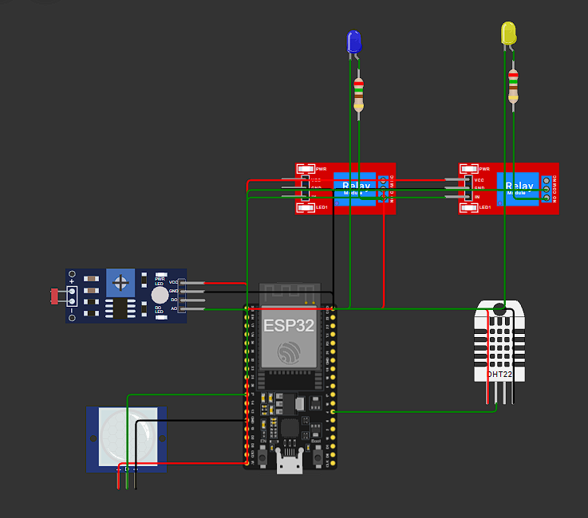

# Smart Room Controller (ESP32)

An IoT system that controls a fan and light only when they are useful:
the room must be occupied, and the temperature or darkness must justify it.

## Features

- Fan turns ON when room is occupied and temperature >= 26°C, OFF at <= 25°C (hysteresis)
- Light turns ON when room is occupied and dark
- Everything turns OFF after a timeout with no motion (saves electricity)
- Non-blocking timers using `millis()`

## Hardware

ESP32 DevKit, DHT22, PIR (HC-SR501), LDR module, 2-channel relay module

## Simulation

Wokwi: https://wokwi.com/projects/480946137911089153

## Status

- [x] Stage 2: Simulation
- [ ] Stage 3: Breadboard prototype
- [ ] Stage 4: Real fan/light via relay
- [ ] Stage 5: MQTT + web dashboard
